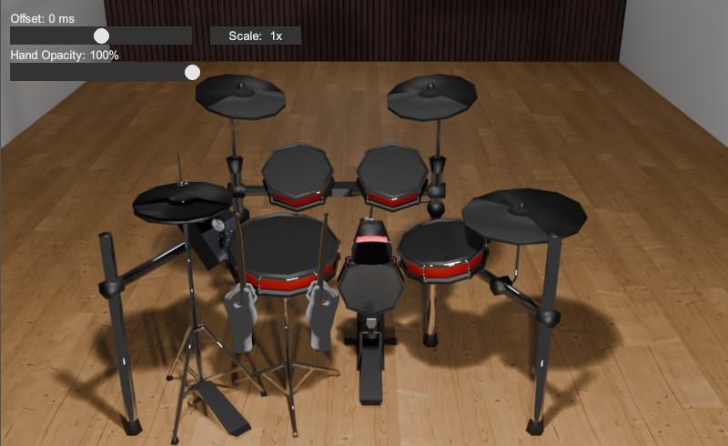

# DrumAnimView

A small Reaper visualization script that turns Rock Band style drummer animation MIDI notes into an animated drum kit view. It reads the notes from a track named `PART DRUMS`, maps them to the appropriate drum positions, and animates the hi-hat opening, kick pedal, and left/right hands in real time as playback or the cursor moves.

## Features

- Animated drum kit visualization based on MIDI drum note data
- Adjustable timing offset, hand opacity, and display scale

## Requirements

- REAPER
- A MIDI drum track called `PART DRUMS`

## Installation - Windows

1. Download .zip from the **Releases** tab
2. Copy `DrumAnimView` folder to `%appdata%\REAPER\Scripts`
3. In REAPER, go to `Actions` **>** `Show action list...`
4. Click `New action...` and then `Load ReaScript`  
	4.1 Navigate to `%appdata%\REAPER\Scripts`  
	4.2. Select `.lua` and click `Open`  
	4.3. Optionally, add a keybind, or use the Menu Editor to add the action to a toolbar

## Usage

1. Create or select a MIDI track named `PART DRUMS`.
2. Add MIDI drum animation notes to it.
3. Run `DrumAnimView.lua` in Reaper.
4. Use the on-screen controls to adjust:
   - **Timing offset**
   - **Hand opacity**
   - **Scale/zoom**
5. Play your project or move the cursor to preview the animation.

## Notes

- The script reads note data from `PART DRUMS` and maps MIDI pitches to visual targets.
- This is a visual aid for reviewing drum timing and feel, not a drum instrument or MIDI editor.
- The included assets in the `assets/` folder are used for the background, kick pedal animation, hi-hat animation, and hand sprites.

## License

This project is provided as-is for personal and creative use. If you plan to redistribute it, please keep the original script and asset files together.